<!-- Perfil de GitHub de sanguino09: copia este README.md y la carpeta assets/ al repo sanguino09/sanguino09 -->

 

 

---

## 👋 Sobre mí

Soy un creador de España apasionado por **convertir ideas 💡 en realidades 🔨**.
Combino la mirada de un **ingeniero aeronáutico** (sistemas, rigor, fiabilidad) con la de un **desarrollador de producto**: me gusta entender el problema, diseñarlo bien y llevarlo a producción.

- 🛫 **Ahora mismo:** analista funcional de proyectos y aplicaciones en **Iberia**
- 🥋 **Construyendo:** **[Kombatly](https://www.kombatly.app)**, la plataforma para academias de artes marciales (clases, alumnos, cinturones, pagos, torneos…)
- 🧠 **Aprendiendo:** arquitectura de producto, rendimiento y seguridad en bases de datos
- 🤝 **Busco:** propuestas, ofertas y proyectos retadores, mejor si es en equipo

> *"Estoy abierto a cualquier propuesta y oferta. Me encanta tomar nuevos retos y afrontarlos de maneras creativas."*

---

## 🧰 Stack

---

## 🥋 Proyecto destacado: Kombatly

Una plataforma completa para que las academias gestionen su día a día y los alumnos entrenen mejor:

- 📅 **Clases y reservas** con aforo, listas de espera y check-in por QR
- 🥋 **Cinturones y progreso** por disciplina
- 💳 **Pagos con Stripe Connect**: membresías, bonos, cursos y planes
- 🏆 **Torneos y ligas** con cuadros, marcadores en vivo y clasificaciones
- 🌍 **6 idiomas**, PWA y app Android
- 🔐 **Seguridad de verdad**: RLS en Postgres, verificación de identidad y cumplimiento RGPD

---

## 📊 Estadísticas

  

---

## 📫 Hablemos

¿Tienes una idea, un proyecto o simplemente quieres charlar? Escríbeme.

 

